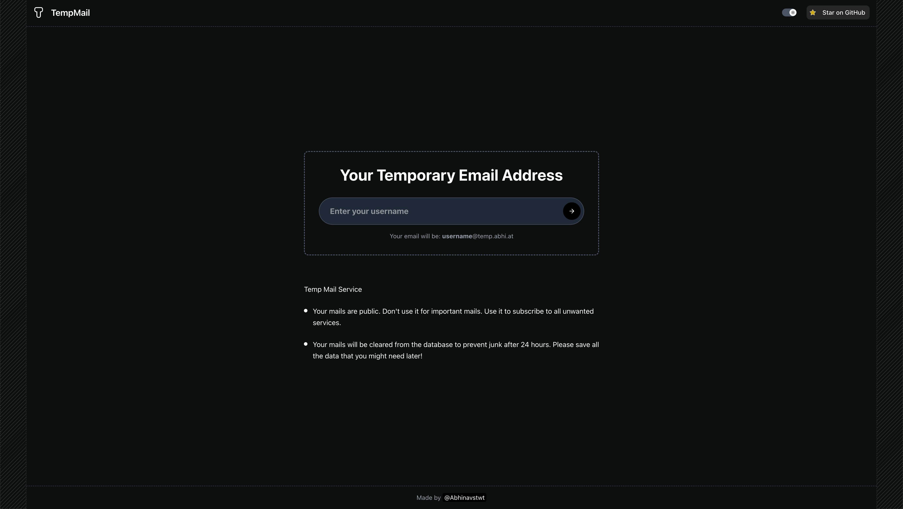

# Temp-Mail

Un servicio de correo electrónico temporal con una interfaz moderna que permite a los usuarios crear direcciones de correo desechables y recibir correos sin necesidad de registrarse.



## Estructura del Proyecto

El proyecto consta de dos partes principales:

### Frontend

- Desarrollado con Next.js 15
- Utiliza React con TypeScript
- Estilizado con Tailwind CSS
- Diseño totalmente adaptable para móviles, tabletas y escritorio
- Ubicado en el directorio `/frontend`

### Backend

- Node.js con Express
- TypeScript
- Servidor SMTP para recibir correos
- Base de datos PostgreSQL con Prisma ORM
- Manejo de errores robusto y recuperación automática
- Ubicado en el directorio `/backend`

## Primeros Pasos

### Requisitos previos

- Node.js (v18+)
- PostgreSQL
- pnpm (recomendado) o npm

### Configuración del Backend

1. Navega al directorio del backend:

```bash
cd backend
```

2. Instala las dependencias:

```bash
pnpm install
```

3. Configura las variables de entorno:

Crea un archivo `.env` en el directorio del backend con el siguiente contenido:

```
# Database
DATABASE_URL=

# Frontend URL for CORS
FRONTEND_URL=
CORS_ORIGIN=

# Backend Configuration
API_PORT=3001
SMTP_PORT=25

# SMTP Configuration
SMTP_DOMAIN=

# Environment
NODE_ENV=production
```

4. Ejecuta las migraciones de la base de datos:

```bash
pnpm prisma migrate dev
```

5. Inicia el servidor del backend:

```bash
# Development mode
pnpm dev

# Production mode
pnpm build
pnpm start
```

### Configuración del Frontend

1. Navega al directorio del frontend:

```bash
cd frontend
```

2. Instala las dependencias:

```bash
pnpm install
```

3. Configura las variables de entorno:

Crea un archivo `.env` en el directorio del frontend con el siguiente contenido:

```
NEXT_PUBLIC_API_BASE=
```

4. Inicia el servidor de desarrollo del frontend:

```bash
# Development mode
pnpm dev

# Production mode
pnpm build
pnpm start
```

5. Abre [http://localhost:3000](http://localhost:3000) en tu navegador para ver la aplicación.

## Arquitectura del Backend

El backend está construido con Node.js y Express, proporcionando tanto un servidor de API como un servidor SMTP para recibir correos.

### Componentes Clave

- **Servidor de API**: Maneja solicitudes HTTP para crear buzones y recuperar mensajes
- **Servidor SMTP**: Recibe correos entrantes y los almacena en la base de datos
- **Base de Datos**: PostgreSQL con Prisma ORM para el almacenamiento y recuperación de datos
- **Creación Automática**: Crea buzones automáticamente cuando sea necesario para mayor resistencia
- **Servicio de Limpieza**: Elimina automáticamente los correos expirados después de 24 horas
- **Verificación de Estado**: Endpoint para verificar el estado del servidor backend
- **Control de Tasa**: Limitación de velocidad inteligente que funciona en entornos de producción con proxies

### Control de Tasa

El backend implementa diferentes límites de tasa basados en la sensibilidad del endpoint:

- **Creación de Buzón**: 5 solicitudes cada 5 minutos
- **Acceso a Mensajes**: 30 solicitudes cada 1 minuto
- **Acceso General a la API**: 100 solicitudes cada 15 minutos

El control de tasa es consciente de los proxies e identifica correctamente las IPs del cliente utilizando:
- Encabezado X-Forwarded-For (común en AWS y otros proveedores en la nube)
- Encabezado CF-Connecting-IP (usado por Cloudflare)
- Encabezado X-Real-IP (usado por varios proxies)
- IP directa como método alternativo

### Endpoints de la API

- `GET /api/health` - Endpoint de verificación de estado
- `POST /api/mailboxes/custom` - Crear un buzón personalizado
- `POST /api/mailboxes/:address/messages` - Obtener mensajes para un buzón
- `GET /api/messages/:id` - Obtener un mensaje específico

### Esquema de la Base de Datos

La base de datos utiliza Prisma ORM con los siguientes modelos principales:

- `Mailbox`: Representa una dirección de correo temporal
- `Message`: Almacena los correos recibidos con su contenido y metadatos

## Arquitectura del Frontend

El frontend está construido con Next.js 15 y React, proporcionando una interfaz de usuario adaptable y moderna.

### Componentes Clave

- **Página de Inicio**: Permite a los usuarios crear direcciones de correo personalizadas
- **Página del Buzón**: Muestra los correos recibidos con funcionalidad de actualización automática
- **Página de Detalle del Mensaje**: Muestra el contenido completo de un correo con soporte para HTML

### Tecnologías Utilizadas

- **Next.js**: Framework de React con App Router
- **React**: Biblioteca de interfaz de usuario para construir componentes
- **TypeScript**: JavaScript con verificación de tipos
- **Tailwind CSS**: Framework de CSS basado en utilidades
- **Sonner**: Notificaciones tipo Toast

### Gestión de Estado

- Hooks de React para la gestión de estado local
- Sondeo inteligente con retroceso exponencial para las solicitudes a la API
- Invalidación de caché (cache-busting) para obtener datos frescos
- Resistencia a errores con degradación elegante

### Diseño Adaptable (Responsive)

- Enfoque móvil primero con diseños adaptables
- Experiencia de visualización optimizada para todos los tamaños de dispositivo
- Elementos de interfaz amigables para pantallas táctiles
- Tipografía y espaciado adaptables

## Desarrollo

### Ejecución de Pruebas

```bash
# Backend tests
cd backend
pnpm test

# Frontend tests
cd frontend
pnpm test
```

### Construcción para Producción

```bash
# Build backend
cd backend
pnpm build

# Build frontend
cd frontend
pnpm build
```

## Despliegue

### Despliegue del Backend

El backend se puede desplegar en cualquier servicio de alojamiento para Node.js:

1. Configura las variables de entorno como se describe arriba
2. Construye el proyecto: `pnpm build`
3. Inicia el servidor: `pnpm start`

### Despliegue del Frontend

El frontend se puede desplegar en Vercel o en cualquier servicio de alojamiento estático:

1. Configura las variables de entorno como se describe arriba
2. Construye el proyecto: `pnpm build`
3. Despliega la carpeta `.next`

## Mejoras Recientes

### Mejoras del Backend

- Se reimplementó el control de tasa listo para producción que funciona con proxies y balanceadores de carga
- Se mejoró la detección de IP para manejar los encabezados X-Forwarded-For, CF-Connecting-IP y X-Real-IP
- Se agregó un manejo de errores robusto y mecanismos de recuperación automática
- Se implementó la creación automática de buzones para mayor resistencia
- Se mejoró el manejo de errores de conexión a la base de datos
- Se mejoró el registro de logs (logging) para una mejor depuración y monitoreo

### Mejoras del Frontend

- Se implementó un diseño totalmente adaptable para todos los tamaños de pantalla
- Se mejoró el manejo de errores con degradación elegante
- Se agregó invalidación de caché para una obtención de datos confiable
- Se mejoró la UI con tamaño y estilo consistentes para los botones
- Se optimizó la visualización del contenido de correos para dispositivos móviles
- Se solucionaron problemas de desplazamiento para correos con contenido extenso
- Se mejoró la retroalimentación visual durante los estados de carga
